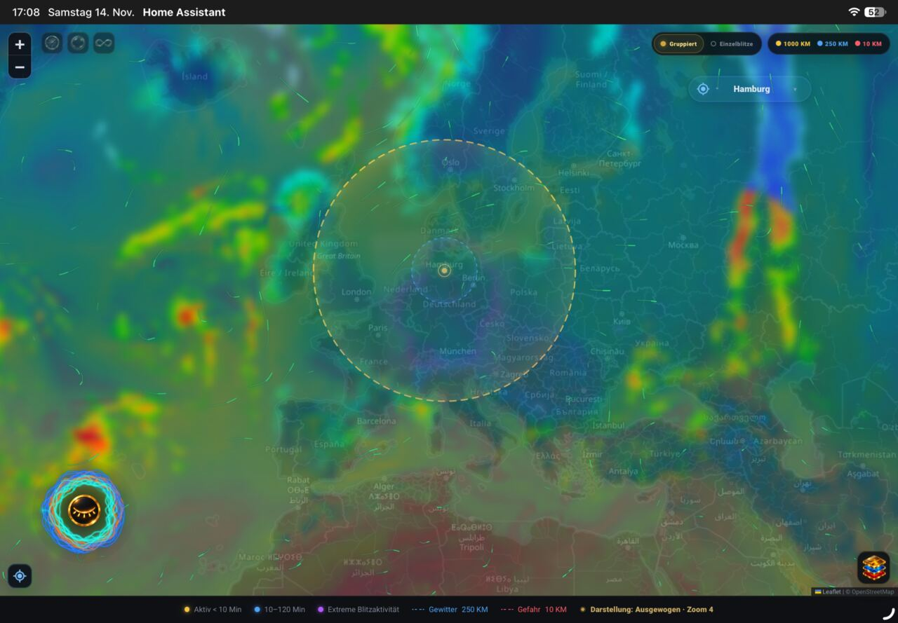
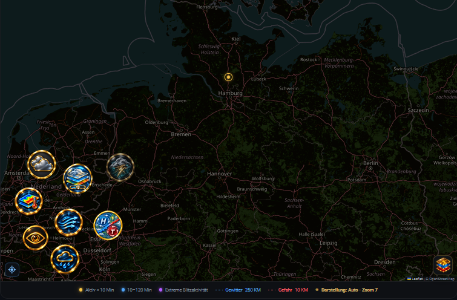
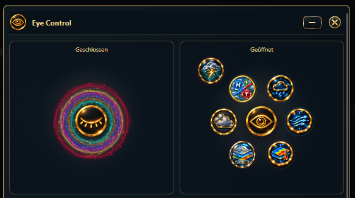

<div align="center">


# GewitterRadar PRO

### Eine Idee weiter gedacht.

**Wetter, Gewitter und Atmosphäre – gemeinsam auf einer interaktiven Karte für Home Assistant.**


**[Grundfunktionen](#die-grundfunktionen-von-gewitterradar)** · **[PRO-Funktionen](#was-gewitterradar-pro-besonders-macht)** · **[Interaktive Bildergalerie](https://thedaimos.github.io/project-hub/gewitterradar-pro.html)** · **[Installation](#installation-in-home-assistant)**

**Konzept und Entwicklung: Christian Köhler**

</div>

> [!IMPORTANT]
> **Stand dieser Entwicklungspräsentation:** GewitterRadar **4.11.243 DEV** / native Home-Assistant-Integration **0.25.150**. Diese Version wurde vom Betreiber funktional und visuell abgenommen und befindet sich im technischen FINAL-Freeze. Die hier gezeigten PRO-Funktionen stammen aus diesem Entwicklungsstand; die Veröffentlichung als `4.11 FINAL` erfolgt erst nach dem Release-Gate. Der produktive stabile Zweig auf `main` bleibt bis dahin **4.10 FINAL**.

<p align="center">
  <a href="https://thedaimos.github.io/project-hub/gewitterradar-pro.html?bild=synoptik#galerie"></a>
</p>

*Ein Wetterbild aus mehreren Perspektiven: großräumige Strömungen, Temperatur- und Niederschlagsfelder sowie Druckgebiete direkt in der Karte. Originalaufnahme aus der 4.11-Entwicklung.*

**[Großansicht mit Bildnavigation öffnen](https://thedaimos.github.io/project-hub/gewitterradar-pro.html?bild=synoptik#galerie)** – mit Chevrons unter dem Bild, Tastaturpfeilen und Wischgesten.

## Die Grundfunktionen von GewitterRadar

GewitterRadar PRO behält sämtliche bewährten Funktionen der klassischen GewitterRadar-Integration. Die neuen Wetterebenen **ergänzen** diese Grundlage und ersetzen sie nicht.

- **Weltweite Standortsuche:** Orte und Postleitzahlen suchen oder geografische Koordinaten direkt eingeben. Zwischen regionaler und großräumiger Karte wechseln.
- **Gespeicherte Orte und Referenzstandort:** Häufig genutzte Beobachtungsorte wieder aufrufen und den eigenen GewitterRadar-Bezugsstandort verwenden. Der zugehörige Tracker kann die Standortreferenz für Blitzortung.org liefern.
- **Live-Blitzereignisse und Gewittercluster:** Einzelereignisse und zusammengefasste Aktivitätsbereiche direkt auf der Karte betrachten und Cluster ansteuern.
- **Beobachtungs-, Gewitter- und Gefahrenradien:** Entfernungen rund um den gewählten Standort visuell einschätzen.
- **Kompass und Trend-Medaillon:** Richtung, Entfernung und Aktivitätsentwicklung schneller einordnen.
- **120-Minuten-Verlauf:** Die jüngste Gewitteraktivität im zeitlichen Zusammenhang verfolgen.
- **Kartenbedienung:** Zoomen, verschieben, Vollbild und gerätegerechte Touch-/Maussteuerung.
- **Persönliche Einstellungen:** Profile, Sicherungen, Hilfebereiche und 19 Sprachvarianten.

Die Blitzortung-Daten stammen weiterhin aus der separaten Home-Assistant-Integration **Blitzortung.org**. GewitterRadar visualisiert sie und ergänzt den Funktionsumfang durch WeatherRouter.

## Was GewitterRadar PRO besonders macht

GewitterRadar begann als interaktive Blitz- und Gewitterkarte. Version 4.11 führt diese Idee weiter: Statt verschiedene Wetterkarten einzeln öffnen zu müssen, lassen sich unterschiedliche meteorologische Zusammenhänge **auf einer gemeinsamen Karte kombinieren**. Die zusätzliche Wetterdatenversorgung erfolgt über das eigenständige Projekt **WeatherRouter**.

| Funktionsbereich | Was zu sehen und zu bedienen ist |
| --- | --- |
| **Blitze und Gewitter** | Live-Ereignisse, Cluster, Beobachtungs- und Gefahrenradien, Kompass und 120-Minuten-Aktivitätsverlauf; für Blitzdaten wird die Home-Assistant-Integration Blitzortung.org verwendet. |
| **Niederschlag** | Wetterradar-Ebenen aus über WeatherRouter bereitgestellten Quellen, darunter DWD und OPERA; optionale NASA-Daten nach Verfügbarkeit. Einheitliche Intensitätsskala und konfigurierbare Premium-Legende. |
| **Wind** | Windfahnen, Pfeile, farbige Flächen und animierte Strömungen einschließlich des eigens entwickelten Snake-Flow-Stils. |
| **Temperatur** | Farbflächen, Werte und Advektionshinweise, als weitere Ebene mit anderen Wetterinformationen kombinierbar. |
| **Wolken und Satelliten** | Wolkenstrukturen und Niederschlag gemeinsam betrachten, um Ausdehnung und Entwicklung von Wettersystemen leichter einzuordnen. |
| **Synoptik** | Hoch- und Tiefdruckkennzeichen, Isobaren und – soweit vom Datenprovider geliefert – meteorologische Fronten. |
| **Eye Hub / Eye Control** | Frei positionierbares zentrales Eye, konfigurierbare Wetter-Icons, optionale Auren, Gruppierung und individuelle Darstellung. |
| **Personalisierung** | Benutzerprofile und Sicherungen, zahlreiche Darstellungsregler, Hilfe & Hinweise und **19 Sprachvarianten** einschließlich vier deutscher Dialektvarianten. |

> [!NOTE]
> Sichtbarkeit und Aktualität der jeweiligen Ebene hängen von Quelle, räumlicher Abdeckung, Zeitpunkt und der Freigabe durch WeatherRouter ab. Ein fehlendes Datenfeld bedeutet nicht automatisch, dass die gesamte Karte nicht funktioniert.

## Einblicke in die Oberfläche

Die folgenden Aufnahmen zeigen **echte Bedienoberflächen aus der Entwicklung** – keine Mock-ups. Je nach Zoom, aktivierten Ebenen, Standort und Zeitpunkt kann die Darstellung abweichen.

<table>
<tr>
<td width="50%" valign="top">
<a href="https://thedaimos.github.io/project-hub/gewitterradar-pro.html?bild=gewitter#galerie"></a>
<br><strong>Gewitterlage auf einen Blick</strong><br>
Viele einzelne Ereignisse und Cluster lassen erkennen, wie sich Gewitteraktivität räumlich verteilt. Die Karte bleibt dabei navigierbar – von der regionalen Beobachtung bis zur großräumigen Ansicht.
</td>
<td width="50%" valign="top">
<a href="https://thedaimos.github.io/project-hub/gewitterradar-pro.html?bild=wetter#galerie"></a>
<br><strong>Wetterebenen im Zusammenspiel</strong><br>
Niederschlagsfarben und weitere meteorologische Felder liegen auf derselben Karte. So werden Übergänge und Zusammenhänge sichtbar, die in isolierten Einzelansichten leicht verloren gehen.
</td>
</tr>
<tr>
<td width="50%" valign="top">
<a href="https://thedaimos.github.io/project-hub/gewitterradar-pro.html?bild=synoptik#galerie"></a>
<br><strong>Wind trifft Synoptik</strong><br>
Animierte Strömungslinien zeigen die Bewegungsrichtung des Windes, während Isobaren und Drucksymbole das großräumige Wettergeschehen erklären. Genau diese Überlagerung gehört zu den besonderen Stärken der PRO-Ausführung.
</td>
<td width="50%" valign="top">
<a href="https://thedaimos.github.io/project-hub/gewitterradar-pro.html?bild=wolken#galerie"></a>
<br><strong>Wolken und Niederschlag</strong><br>
Feine Wolkenstrukturen bilden den atmosphärischen Hintergrund; darüber macht die Niederschlagsebene aktive Wetterbereiche sichtbar. Eine anschauliche Ergänzung zum klassischen Radarbild.
</td>
</tr>
</table>

### Eye Hub – das Wetter im direkten Zugriff

<table>
<tr>
<td width="55%" valign="top">
<a href="https://thedaimos.github.io/project-hub/gewitterradar-pro.html?bild=karte#galerie"></a>
<br><strong>Direkt auf der Karte</strong><br>
Die Wetter-Icons dienen als intuitive Schaltzentrale. Mit wenigen Berührungen lassen sich Ansichten wechseln und Ebenen bedienen, ohne die Karte verlassen zu müssen.
</td>
<td width="45%" valign="top">
<a href="https://thedaimos.github.io/project-hub/gewitterradar-pro.html?bild=eye-control#galerie"></a>
<br><strong>Eye Control</strong><br>
Das zentrale Eye und die umliegenden Icons lassen sich konfigurieren. Die optionale Aura-Gestaltung macht die Steuerung nicht nur funktional, sondern zu einem eigenen visuellen Element.
</td>
</tr>
</table>

## Entwickelt für unterschiedliche Geräte

Die Oberfläche wird auf Desktop-Browsern, Tablets und Smartphones eingesetzt. Kartenbedienung, Menüs, Wetter-Icons und Eye Control sind auf Maus- wie Touchbedienung ausgelegt. Die Bedienoberfläche wurde vom Projektbetreiber auf Notebook, iPad und Smartphone praktisch geprüft. Automatisierte CI- und Browsertests sind davon getrennte technische Nachweise.

## Installation in Home Assistant

### Native Integration – empfohlen

1. In **HACS → Benutzerdefinierte Repositories** die URL `https://github.com/TheDaimos/gewitterradar` als Typ **Integration** eintragen.
2. Die angebotene und zum gewünschten Kanal passende Version installieren. **Stabile 4.10 und DEV 4.11 bewusst unterscheiden.**
3. Home Assistant nach Installationshinweis neu starten.
4. Unter **Einstellungen → Geräte & Dienste** die Integration **Gewitterradar** hinzufügen.
5. Falls nicht automatisch vorhanden, unter **Dashboards → Ressourcen** das JavaScript-Modul `/gewitterradar/gewitterradar.js` registrieren.
6. In einer Panel-Ansicht eine manuelle Karte anlegen:

```yaml
type: custom:gewitterradar-card
```

Für Live-Blitzdaten muss die unabhängige Integration **Blitzortung.org** eingerichtet und mit der gewünschten Standort-/Tracker-Konfiguration verbunden sein. Die erweiterten PRO-Wetterebenen setzen einen kompatiblen, separat eingerichteten **WeatherRouter** voraus; ohne ihn bleiben die darauf aufbauenden Wetterfunktionen nicht verfügbar.

### Alternative Dashboard-/Lovelace-Auslieferung

Für bestehende Package-Installationen gibt es die separate Dashboard-Variante unter [`TheDaimos/gewitterradar-dashboard`](https://github.com/TheDaimos/gewitterradar-dashboard). Sie ist nicht mit der nativen Integration gleichzusetzen. Die vollständigen Schritte einschließlich `/config/packages/` stehen in der [Installationsanleitung](docs/INSTALLATION.md).

> [!CAUTION]
> **Keine automatische PROD-Promotion:** Der hier gezeigte 4.11-Stand ist ein DEV-/FINAL-Kandidat. DRA-Installationen, Home-Assistant-PROD und stabile Veröffentlichungen bleiben vom reinen README-Update unberührt.

## Dokumentation und Projektstand

- [Installationsanleitung](docs/INSTALLATION.md) und [HTML-Handbuch](https://thedaimos.github.io/gewitterradar/)
- [Release-Freeze 4.11.243](docs/GR_V411_RELEASE_FREEZE_AND_CLOUDS_CLOSE_411243_2026-11-19.md)
- [Technische FINAL-Gates](docs/GR_411243_FINAL_TECHNICAL_GATE_AUDIT_2026-11-19.md) und [Gate-Reparaturen](docs/GR_411243_FINAL_GATE_REPAIR_2026-11-19.md)
- [Historische README mit Installationsdetails und DEV-Changelog](docs/archive/README_DEV_BEFORE_PRO_SHOWCASE_2026-11-19.md)

### Lizenz und Urheberschaft

**Originalentwicklung und ursprünglicher Urheber: Christian Köhler.**

Die rechtlich verbindlichen Bedingungen richten sich nach der **jeweils installierten Veröffentlichung und deren Lizenzdatei**. Historisch unter GPL veröffentlichte Fassungen behalten ihre damaligen Nutzungsrechte. Die geplante Gemeinschaftslizenz **Modell B** für künftige Veröffentlichungen ist im [Lizenzentwurf](docs/PROPOSED_COMMUNITY_LICENSE_CHRISTIAN_KOEHLER.md) beschrieben; diese README setzt keine neue Lizenz in Kraft.

<p align="center"><em>GewitterRadar PRO – Eine Idee weiter gedacht.</em><br><strong>Konzept und Entwicklung: Christian Köhler</strong></p>
