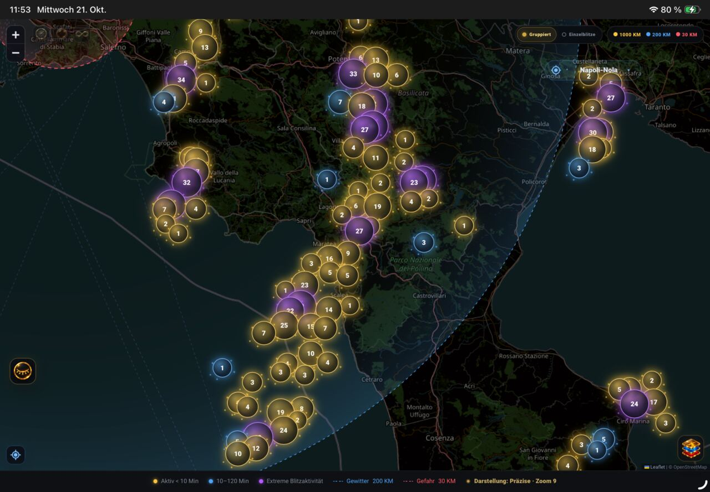
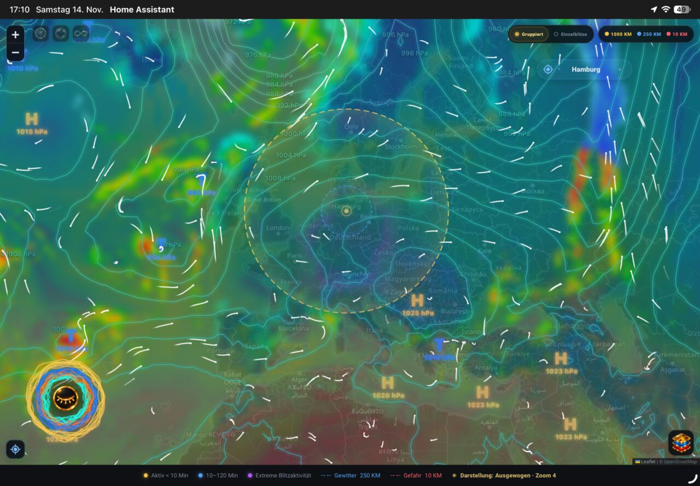
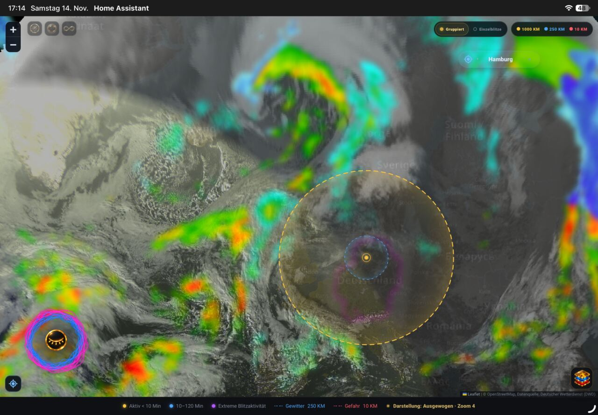

**Originalentwicklung und ursprünglicher Urheber: Christian Köhler**

> **V4.13 FINAL · Gemeinschaftslizenz Modell B.**
> Aktueller stabiler Release: [v4.13](https://github.com/TheDaimos/gewitterradar/releases/tag/v4.13).
> Vorheriger Rückfallstand: [V4.10 FINAL Modell B](https://github.com/TheDaimos/gewitterradar/releases/tag/v4.10-model-b-20261109).
> Frühere rechtmäßig gewährte GPL-Rechte bleiben bestehen; historische Fassungen werden nicht rückwirkend umlizenziert.
> Der Entwicklungszweig `deploy/dev` bleibt für künftige Änderungen getrennt.
> [Lizenz](LICENSE.md) · [Installationsanleitung](https://github.com/TheDaimos/gewitterradar/blob/main/docs/INSTALLATION.md).
> Modell B ist keine OSI-anerkannte Lizenz: keine offizielle HACS-Katalog-Lizenzfreigabe. Benutzerdefinierte Repositories und manuelle Installation sind getrennte Wege.

<div align="center">


# Gewitterradar

### Live-Blitz- und Gewitterdarstellung für Home Assistant

**Native Home-Assistant-Integration · Dashboard-Karte · weltweite Referenzorte · 120-Minuten-Verlauf**


**[⚡ Native Integration installieren](#1-native-gewitterradar-integration)** ·
**[🌩️ Funktionen](#was-gewitterradar-bereitstellt)** ·
**[📖 HTML-Handbuch](https://thedaimos.github.io/gewitterradar/)**

</div>

> [!IMPORTANT]
> **GewitterRadar wird als native Home-Assistant-Integration installiert.**
> Sie stellt eigene Entitäten bereit und benötigt kein YAML-Helferpaket. Die optionale Dashboard-Karte ist Bestandteil der Integration.

<p align="center">
  
</p>

**Vollständige Installation:** [docs/INSTALLATION.md](docs/INSTALLATION.md) ·
**Hilfe & Überblick:** [docs/gewitterradar-overview.html](https://thedaimos.github.io/gewitterradar/)

---

## GewitterRadar PRO 4.11 – Einblicke in die nächste Generation

<div align="center">


**Eine Idee weiter gedacht. · Konzept und Entwicklung: Christian Köhler**

</div>

> [!NOTE]
> Die folgenden Originalaufnahmen stammen aus **4.11.243 DEV / HA 0.25.150** (funktional und visuell abgenommener FINAL-Kandidat). Zusätzliche PRO-Wetterebenen benötigen einen kompatibel eingerichteten WeatherRouter.

GewitterRadar bewahrt seine bewährten Grundlagen: **weltweite Standortsuche**, Orte und Postleitzahlen, direkte Koordinaten, gespeicherte Referenzorte, Live-Blitze, Gewittercluster, Beobachtungs- und Gefahrenradien, Kompass und **120-Minuten-Verlauf**. PRO erweitert das Konzept um gemeinsam nutzbare Ebenen für Niederschlag, Wind einschließlich Snake Flow, Temperatur, Wolken und Synoptik mit Hoch-/Tiefdruckgebieten, Isobaren und Wetterfronten.

<table>
<tr>
<td width="50%" valign="top"><a href="https://thedaimos.github.io/gewitterradar/gewitterradar-overview.html?bild=gewitter#pro-gallery"></a><br><strong>Live-Blitze und Cluster</strong><br>Gewitteraktivität räumlich erfassen, lokale Wetterlagen beobachten und per Standortsuche in andere Regionen wechseln.</td>
<td width="50%" valign="top"><a href="https://thedaimos.github.io/gewitterradar/gewitterradar-overview.html?bild=synoptik#pro-gallery"></a><br><strong>Wind und Synoptik</strong><br>Animierte Windströmungen mit Isobaren und Hoch-/Tiefdrucksymbolen auf derselben Karte betrachten.</td>
</tr>
<tr>
<td width="50%" valign="top"><a href="https://thedaimos.github.io/gewitterradar/gewitterradar-overview.html?bild=wolken#pro-gallery"></a><br><strong>Wolken und Niederschlag</strong><br>Satellitenartige Wolkenstrukturen und farbige Niederschlagsfelder gemeinsam erkunden.</td>
<td width="50%" valign="top"><a href="https://thedaimos.github.io/gewitterradar/gewitterradar-overview.html?bild=eye-control#pro-gallery"></a><br><strong>Eye Hub und Eye Control</strong><br>Frei konfigurierbare Wetter-Icons, Auren und eine Touch-freundliche Steuerung der Wetterebenen.</td>
</tr>
</table>

**[Alle sechs Ansichten mit Bildnavigation und mehrsprachigen Erklärungen öffnen](https://thedaimos.github.io/gewitterradar/gewitterradar-overview.html#pro-gallery)** · **[Aktuelle DEV-Projektvorstellung](https://github.com/TheDaimos/gewitterradar/blob/deploy/dev/README.md)**

---

## Schnellnavigation

[Installation](#installation) · [View einrichten](#view-einrichten) · [Blitzortung koppeln](#blitzortung-koppeln) · [Recorder schützen](#recorder-schützen) · [Bestehende Installationen](#bestehende-installationen) · [Fehlersuche](#fehlersuche) · [Dokumentation](#dokumentation)

---

## Was Gewitterradar bereitstellt

- Live-Blitzdarstellung aus der Home-Assistant-Integration **Blitzortung.org**;
- Beobachtungs-, Gewitter- und Gefahrenradius;
- Cluster-Darstellung und Cluster-Navigation;
- Kompass und Trend-Medaillon;
- 120-Minuten-Aktivitätsverlauf;
- weltweite Orts-/PLZ-Suche und direkte Koordinateneingabe;
- gespeicherte Orte;
- dynamischen Gewitterradar-Bezugsstandort;
- vollständigen Bereich **Hilfe & Hinweise**;
- **15 Sprachen plus 4 deutsche Dialektvarianten = 19 Sprachvarianten**;
- Diagnose-, Kalibrier-, Geometrie- und Testwerkzeuge.

> [!NOTE]
> Gewitterradar ersetzt **Blitzortung.org nicht**. Die Blitzortung-Integration muss vorhanden und funktionsfähig sein. Sie bleibt Eigentümerin ihrer Datenregion und Abonnementlogik.

---

# Installation

## 1. Native Gewitterradar-Integration

1. Dieses Repository in HACS als benutzerdefiniertes Repository vom Typ **Integration** hinzufügen.
2. **Gewitterradar Integration** installieren.
3. Home Assistant vollständig neu starten, wenn HACS dies verlangt.
4. **Einstellungen → Geräte & Dienste → Integration hinzufügen** öffnen.
5. Nach **Gewitterradar** suchen und den Config Entry anlegen.
6. Unter **Einstellungen → Dashboards → Ressourcen** folgende Ressource als **JavaScript-Modul** eintragen:

```text
/gewitterradar/gewitterradar.js
```

Eine frische native Installation benötigt **kein** historisches YAML-Helferpaket.

### Erwartetes Ergebnis

- Gewitterradar bleibt nach einem Neustart unter **Einstellungen → Geräte & Dienste → Integrationen** sichtbar;
- der Config Entry ist geladen;
- die nativen Gewitterradar-Konfigurationsentitäten sind vorhanden;
- gespeicherte Werte bleiben erhalten;
- die Dashboard-Karte kann aus derselben Installation verwendet werden.

---

# View einrichten

GewitterRadar kann direkt über die Seitenleiste geöffnet werden. Eine eigene Dashboard-View ist optional.

## Minimal-Konfiguration

Neue Panel-Ansicht anlegen und eine **Manuelle Karte** hinzufügen:

```yaml
type: custom:gewitterradar-card
```

## Vollständiges View-Beispiel

```yaml
views:
  - title: Gewitterradar
    path: gewitterradar
    icon: mdi:weather-lightning
    type: panel
    cards:
      - type: custom:gewitterradar-card
```

Falls der Blitzortung-Zähler nicht `sensor.home_lightning_counter` heißt:

```yaml
type: custom:gewitterradar-card
counter_entity: sensor.DEIN_LIGHTNING_COUNTER
```

---

# Blitzortung koppeln

Für weltweite Standortwechsel sollte Blitzortung.org den jeweils passenden Gewitterradar-Tracker als **Location entity** verwenden.

```text
device_tracker.gewitterradar
```

Ablauf:

1. Standort in Gewitterradar suchen oder Koordinaten übernehmen.
2. Gewitterradar verschiebt den eigenen Referenztracker.
3. Blitzortung.org erkennt die Positionsänderung über die konfigurierte Location Entity.
4. Neuabonnement, Aktualisierung und Latenz der Blitzdaten bleiben Aufgabe der Blitzortung.org-Integration.

Gewitterradar verändert keine fremden Config Entries und schreibt nicht direkt in private Home-Assistant-`.storage`-Dateien.

---

# Recorder schützen

Bei hoher Blitzaktivität können sehr viele Zustandsänderungen entstehen. Die kurzlebigen Blitzentitäten sollten deshalb nicht dauerhaft im Recorder gespeichert werden.

```yaml
recorder:
  exclude:
    entity_globs:
      - "geo_location.lightning_strike*"
      - "sensor.*_lightning_distance"
      - "sensor.*_lightning_azimuth"
      - "sensor.*_lightning_counter"
```

Falls bereits ein `recorder:`-Block existiert, die Einträge dort ergänzen. **Keinen zweiten `recorder:`-Hauptschlüssel anlegen.**

Die Ausschlüsse betreffen nur die zukünftige Datenbank-/History-Speicherung. Die Live-Zustände bleiben für Gewitterradar verfügbar.

Mehr dazu: [docs/RECORDER.md](docs/RECORDER.md)

---

# JavaScript-Ressourcen prüfen

Es darf genau **eine** Gewitterradar-Ressource aktiv sein:

**Native Integration**

```text
/gewitterradar/gewitterradar.js
```

Veraltete, parallele oder Test-Ressourcen entfernen bzw. deaktivieren. Nach einer Änderung den Browser vollständig neu laden; bei hartnäckigem Cache gegebenenfalls einen Hard-Reload durchführen.

---

# Bestehende Installationen

Beim ersten nativen Setup können unterstützte gültige `lightning_detection_*`-Legacy-Werte einmalig übernommen werden. Bereits vorhandene native Werte haben Vorrang. Legacy-Helfer werden nicht gelöscht oder überschrieben.

Veraltete Ressourcen und nicht mehr benötigte Helfer erst nach Prüfung deaktivieren.

Details: [docs/MIGRATION_AND_ROLLBACK.md](docs/MIGRATION_AND_ROLLBACK.md)

---

# Manuelle Installation der nativen Integration

Ohne HACS den vollständigen Ordner

```text
custom_components/gewitterradar/
```

nach

```text
/config/custom_components/gewitterradar/
```

kopieren.

Der Zielordner muss mindestens enthalten:

```text
/config/custom_components/gewitterradar/
├── __init__.py
├── config_flow.py
├── const.py
├── device_tracker.py
├── manifest.json
├── number.py
├── select.py
├── strings.json
├── switch.py
├── frontend/
│   ├── gewitterradar.js
│   ├── assets/
│   └── locales/about-locales.js
├── brand/
│   ├── icon.png
│   └── icon@2x.png
└── translations/
    ├── de.json
    └── en.json
```

Danach Home Assistant vollständig neu starten, Gewitterradar über **Einstellungen → Geräte & Dienste** hinzufügen und anschließend die Ressource `/gewitterradar/gewitterradar.js` registrieren.

---

# Prüfung nach der Installation

- nur eine Gewitterradar-JavaScript-Ressource aktiv;
- Karte und Radien werden dargestellt;
- Live-Blitze bzw. vorhandene 120-Minuten-Historie erscheinen;
- Kompass und Trend-Medaillon funktionieren;
- weltweite Ortssuche und direkte Koordinateneingabe funktionieren;
- der Gewitterradar-Tracker ändert bei einem Standortwechsel seine Koordinaten;
- Blitzortung.org verwendet den passenden Tracker als Location Entity;
- Hilfe-/Hinweisbereich und Recorder-Hinweis sind verfügbar;

Bei der nativen Variante zusätzlich prüfen, dass die Integration nach einem Neustart geladen bleibt und ihre Einstellungen erhalten bleiben.

---

# Fehlersuche

| Symptom | Prüfen |
| --- | --- |
| Karte erscheint nicht | JavaScript-Ressource, Browser-Cache, genau eine aktive Gewitterradar-Ressource |
| Keine oder zu wenige Blitze | Blitzortung.org-Status, Quellradius, verwendete Entitäten |
| Standort wechselt, Blitzdatenregion nicht | Blitzortung.org muss den Gewitterradar-Tracker als **Location entity** verwenden |
| Backup/Datenbank wächst stark | Recorder-Ausschlüsse für Blitzentitäten prüfen |
| Sprache/Hilfe wirkt veraltet | Browser neu laden und sicherstellen, dass nur die aktuelle `locales/about-locales.js` ausgeliefert wird |
| Doppelte oder widersprüchliche Einstellungen | alte Packages/Ressourcen deaktivieren |

---

# Projektstand, Qualität und Schutz

V4.10 FINAL bewahrt die geschützten Vorgängerstufen und die weiterhin geschützte V4.07.56-Diagnosebasis. Für Entwicklung und Produktpflege gibt es nur **ein GewitterRadar**: die native Integration.

Besonders geschützt sind:

- der abgenommene V4.05-Stand von **„Über Gewitterradar“** einschließlich Widmung „Für Alkje“, Slogan, Hero-/Widmungs-Assets, Recorder-Hinweis, Radien-Semantik und Onboarding;
- der normale UI-/Funktionsstand ab V4.07.54;
- der Diagnosevertrag ab V4.07.56;
- sämtliche Hi-Res-/Mastergrafiken einschließlich nicht mehr aktiver Legacy-Varianten;
- der Release-/Golden-Master-Prozess.

Verbindliche Dokumente:

- [ABOUT_GEWITTERRADAR_ACCEPTANCE_BASELINE_V4_05.md](docs/ABOUT_GEWITTERRADAR_ACCEPTANCE_BASELINE_V4_05.md)
- [DIAGNOSTIC_PROTECTION_V4_07_56.md](docs/DIAGNOSTIC_PROTECTION_V4_07_56.md)
- [ASSET_RETENTION_POLICY.md](docs/ASSET_RETENTION_POLICY.md)
- [GOLDEN_MASTER_POLICY.md](docs/GOLDEN_MASTER_POLICY.md)
- [RELEASE_PROCESS.md](docs/RELEASE_PROCESS.md)

Die Release-Linie wird unter anderem über Home-Assistant-Laufzeittests, Hassfest, HACS-Validierung, deterministisches Integrations-Staging, Locale-/Recorder-Prüfungen, Browserregressionen, Golden-/Geometrievertrag, Diagnosevertrag und Hi-Res-Retentionsvertrag abgesichert.

Ein grüner Laufzeittest ersetzt keine HACS-/Hassfest-Prüfung; eine statische Packaging-Prüfung ersetzt keinen realen HACS-Installationstest.

---

# Dokumentation

- [HTML-Handbuch](https://thedaimos.github.io/gewitterradar/)
- [Installation](docs/INSTALLATION.md)
- [Recorder](docs/RECORDER.md)
- [Migration und Rückfall](docs/MIGRATION_AND_ROLLBACK.md)
- [Real-Install-Erkenntnisse](docs/REAL_INSTALL_FINDINGS_2026-09-06.md)
- [Projektgeschichte](docs/HISTORY.md)
- [Release-Ablauf](docs/RELEASE_PROCESS.md)
- [Golden-Master-Richtlinie](docs/GOLDEN_MASTER_POLICY.md)

---

# Lizenz und Branding

Die aktuelle Modell-B-Lizenzedition von GewitterRadar steht unter der [Gewitterradar-Gemeinschaftslizenz](LICENSE.md).

Copyright © 2026 **Christian Köhler / TheDaimos**. Originalentwicklung und ursprünglicher Urheber: **Christian Köhler**.

Private, nichtberufliche Nutzung und Entwicklung sind kostenlos. Kostenlose Weitergabe erfordert den vollständigen erforderlichen Quellcode und dieselben Lizenzbedingungen. Berufliche, dienstliche, organisatorische oder kommerzielle Nutzung erfordert vorherige ausdrückliche schriftliche Genehmigung. Maßgeblich ist der vollständige Lizenztext.

Logos und Projektkennzeichen sind gesondert geschützt; ihre bestimmungsgemäße Darstellung ist gestattet. Siehe [BRANDING.md](BRANDING.md), [COPYRIGHT.md](COPYRIGHT.md) und [AUTHORS.md](AUTHORS.md).

Modell B ist keine OSI-anerkannte Open-Source-Lizenz. Rechte Dritter und bereits rechtmäßig gewährte Rechte bleiben unberührt. Die Originalwidmung **Für Alkje** bleibt unverändert.

### R19 Medaillon-/Pfeil-Kalibrierung

Für die aktuelle V4.10.02-Entwicklung enthält die Diagnose ein vollständiges Kalibrierwerkzeug für die 28 Trend-Medaillons und 18 Pfeile: automatische Augenmessung, frei verschiebbarer Augen-Referenzkreis mit Radiusgriff, manuelle X/Y/Radius-Abnahme, 360°-Fit gegen den 4-%-Sicherheitsbereich, automatische/manuelle Pfeilgröße, automatischer/manueller Pfeilmittelpunkt X/Y, 504er-Fit-Matrix, Abnahme-/Invalidierungslogik sowie FIT-, AUGE- und KAL-Exporte.

Die Diagnosewerte verändern die Produktdarstellung nicht automatisch.

Dokumentation: [R19 Augenreferenz und Pfeilkalibrierung](docs/R19_MEDALLION_EYE_CALIBRATION_2026-09-27.md), [Medaillon-/Pfeil-Geometriedatenbank](docs/MEDALLION_ARROW_GEOMETRY_DB.md), [Medaillon-/Pfeil-Katalog](docs/MEDALLION_CATALOG.md).


### Projektstatistik

Die historische Entwicklungsmenge von der Vor-Git-V3.x-Phase bis zur aktuellen V4.10-Linie wird separat und mit ausgewiesener Unsicherheit dokumentiert: [Projektstatistik](docs/PROJECT_STATISTICS.md).
