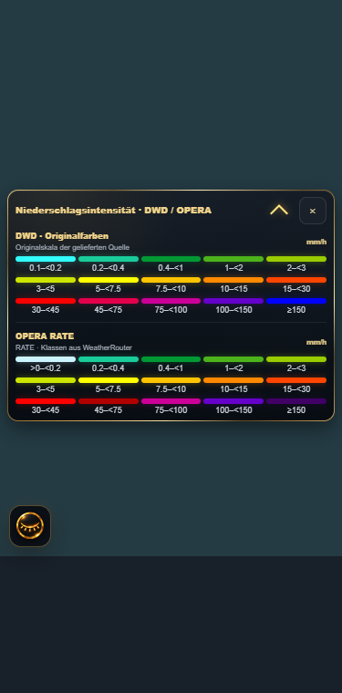
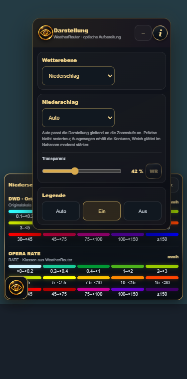
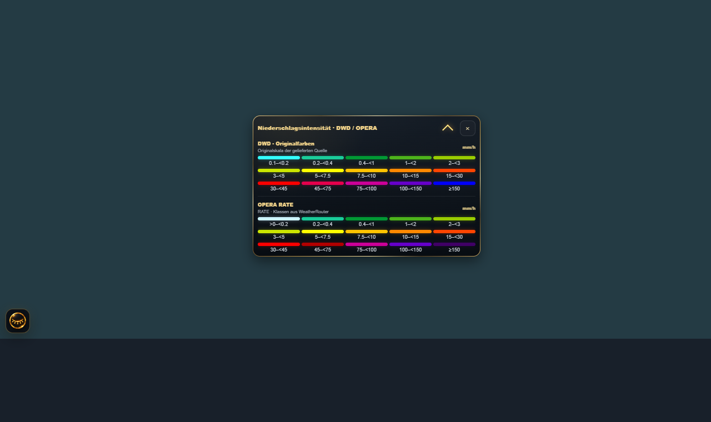

# GR-LEGEND-UI-03 · Abschlussbericht · 2026-11-06

WR 0.10.291 DEV / Loader 294; GR 4.11.144 DEV / HA 0.25.51. Ausschließlich deploy/dev.

## Kernauftrag

OPERA rendert die neue Farbfolge direkt aus unveränderten numerischen RATE-Werten.
Die vorhandenen 15 Grenzen bleiben identisch. rate_legend erzeugt aktive Legenden
aus derselben Tabelle RATE_COLORS; es gibt keine neue RGB-Rückrechnung.
GR verwendet für aktive Quellen die vorhandenen WR-Legendenmetadaten. Die
Ein-Referenz ohne aktive Quellen ist ein daraus generierter Build-Snapshot,
keine unabhängig editierte Rendererpalette. Die alte WR289-Skala bleibt nur als
historischer Kompatibilitätsfall für alte Antworten ohne Metadaten bestehen.

| Klasse | mm/h (untere Grenze inklusiv, außer >0) | RGB | RGBA |
|---|---|---|---|
| 1 | >0 bis <0.2 | (204, 244, 255) | (204, 244, 255, 255) |
| 2 | 0.2 bis <0.4 | (26, 204, 154) | (26, 204, 154, 255) |
| 3 | 0.4 bis <1 | (1, 153, 52) | (1, 153, 52, 255) |
| 4 | 1 bis <2 | (77, 179, 27) | (77, 179, 27, 255) |
| 5 | 2 bis <3 | (153, 204, 1) | (153, 204, 1, 255) |
| 6 | 3 bis <5 | (204, 230, 1) | (204, 230, 1, 255) |
| 7 | 5 bis <7.5 | (255, 255, 1) | (255, 255, 1, 255) |
| 8 | 7.5 bis <10 | (255, 196, 1) | (255, 196, 1, 255) |
| 9 | 10 bis <15 | (255, 137, 1) | (255, 137, 1, 255) |
| 10 | 15 bis <30 | (255, 69, 1) | (255, 69, 1, 255) |
| 11 | 30 bis <45 | (254, 0, 0) | (254, 0, 0, 255) |
| 12 | 45 bis <75 | (178, 0, 0) | (178, 0, 0, 255) |
| 13 | 75 bis <100 | (204, 0, 152) | (204, 0, 152, 255) |
| 14 | 100 bis <150 | (102, 0, 203) | (102, 0, 203, 255) |
| 15 | ≥150 | (64, 0, 102) | (64, 0, 102, 255) |

Null, negative und nicht-endliche Werte bleiben transparent; NoData und Undetect
werden weiterhin vor der Farbgebung maskiert. Deckkraft und Messwerte unverändert.

## Tatsächliche Providervereinheitlichung

Die neue 15-Farbenfolge ist für den numerischen OPERA-Renderer umgesetzt.
DWD liefert bereits eingefärbte WMS-Bilder; GetStyles bietet den Standardstil
`niederschlagsradar`, keinen verifizierten Stil mit genau dieser Zielfolge.
Es wird kein ungetestetes SLD_BODY eingeschleust und kein RGB-Wert zurückgerechnet.
Die DWD-Raster bleiben daher unverändert. Für genau den verifizierten Standardstil
liefert WR native Original-Farbmetadaten, zentral neben der RATE-Tabelle definiert.
Andere DWD-Stile bleiben bei ihrem Originalverweis. Abweichungen: DWD nutzt
Türkis statt Hellblau unten, Magenta bei 45–75 und reines Blau ab 150 mm/h; OPERA
verwendet dort Hellblau, Dunkelrot und Dunkelviolett. Die WMS-SLD enthält gerundete
Fünf-Minuten-Mengen; die native Skala folgt deren veröffentlichten mm/h-Labels,
nicht unverändert übernommenen quantity-Werten. DWD-NoData kann grau sein und
unter ca. 0.1 mm/h ist dessen Stil transparent; das wird nicht als OPERA-Nullwert interpretiert.

NASA bleibt bei der gelieferten Originalfarbgebung. Numerische RATE-Felder sind
in diesem GR-Transport nicht verfügbar, sondern GIBS-WMS-PNGs. Es wird keine
gleiche Farbphysik für satellitengeschätzten Regen und Schnee behauptet. Nicht
verifizierbare Farbinformationen bleiben als kompakter Original-Link erreichbar.

Quelle DWD: https://maps.dwd.de/geoserver/dwd/wms?service=WMS&request=GetStyles&version=1.1.1&layers=dwd:Niederschlagsradar

## Premium-UI

Ein gemeinsames Fenster, dynamische Kopfzeile aus tatsächlich ausgewählten
Quellen: Niederschlagsintensität · DWD / OPERA, gegebenenfalls / NASA.
Identische Einträge/Einheiten werden gruppiert; abweichende Skalen bleiben als
kompakte native Abschnitte erhalten. Keine eingebetteten WMS-Legendenbilder.
Alle Intervalle sind ausgeschrieben; fünf Spalten, auch mobil, 9 px-Beschriftung.
Die Liste scrollt bei Bedarf innerhalb der begrenzten Kartenfläche.

Wiederverwendung aus ui/skeleton.js:
- identischer Metallverlauf der `settings-dialog`-Rahmenregel, auf die neue
  Klasse gr-premium-metal-surface erweitert; bestehende Dialogselektoren unverändert;
- vorhandene release-history-future-chevron inklusive Drehung, Schatten und
  .42s cubic-bezier(.22,1,.36,1)-Transition; keine neue Chevron-Animation;
- Premium-Farbvariablen und dezenterer Schatten für das kleine Overlay.

Die Klapptaste verwendet aria-expanded/inert. Nur der Inhalt klappt ein, die
Kopfzeile bleibt sichtbar. Ein Pixelanker verhindert Sprünge beim Klappen;
Resize begrenzt erneut an die Karte. Maus-/Touch-Drag und gespeicherte relative
Position bleiben erhalten. Auto/Ein/Aus ist weiterhin dieselbe Zustandsverwaltung.
WR und Info verwenden denselben Metallrahmen, zentrierte Grid-Ausrichtung sowie
vorhandene Hover-/Aktiv-Effekte; WR-Beschriftung 9 px. Minimieren bleibt links vom i.
Transparenz, Prozentanzeige und Erklärungstexte aus UI-01 bleiben erhalten.

Nachweise (synthetischer lokaler Chromium-Prüfstand, keine HA-Realabnahme):

## NASA: räumliche Mosaikprüfung

Die bestehende raster_mosaic_policy.py weist coverage_verified ausdrücklich nur
als verifizierte Hülle aus, nicht als Pixelmaske. Der V2-Vertrag besitzt globale
oder einzelne rechteckige Abdeckung und geordnete Overlays; keine belegungsgenaue
Subtraktionsmaske. Transparente Pixel können trockene Werte oder fehlende Daten
repräsentieren; aus ihren RGB-/Alpha-Werten wird keine neue fachliche Belegung
abgeleitet. Das bestehende NASA-Bild als Hintergrund wäre keine nachgewiesene
überlagerungsfreie Lückenfüllung. Sichere grobe Auswahl außerhalb regionaler
Hüllen ersetzt keine Lösung für die Lücken innerhalb dieser Hüllen.

Deshalb wird die optionale neue NASA-Mosaikerweiterung nicht implementiert oder
aktiviert. Es wird kein scheinbar funktionsfähiger Schalter veröffentlicht.
Die vorhandene NASA-Darstellung, DWD-/OPERA-Auswahl und deren Prioritäten bleiben
vollständig unverändert. Keine neue Engine, kein Provider, keine neue GR-Zeitpolitik.
NASA-Unterzeilen kennzeichnen Satellitenschätzung, WR-Bildzeit und gegebenenfalls
älteren Hintergrund gemäß WR. Keine gemeinsame Beobachtungszeit wird vorgetäuscht.

## NASA: reale Größenmessung und Speicherrechnung

Messdatum 06.11.2026; sechs begrenzte GetMap-Abrufe,256×256 RGBA, Zoom4,
drei europäische Quellkacheln und zwei historische Zeitpunkte (05.11.00:00/00:30UTC).
Vier gültige PNGs, zwei TLS-Resets. PNG-Größen:4180,8517,3541,676 Byte.
Mittel 4228.5 Byte; beobachtetes Maximum 8517 Byte. Antwortzeiten 0.474–0.568s.
Ein separater Vorlauf lieferte 4155 Byte; er ist nicht in diesem Mittel enthalten.
Dies ist keine globale Größenobergrenze und keine Messung typischer VM109-Nutzung.
Aktuelle Produktlatenz ist aus historischen Probeabrufen nicht bestimmbar;
Abrufzeit wird nicht als Beobachtungszeit ausgegeben. Metadatenzugriffe waren
teilweise nicht erreichbar. Die Samplezeitpunkte sind keine Aussage des neuesten
verfügbaren IMERG-Zeitpunkts oder einer WR-Zulassung dieser historischen Frames.

Alle vier erfolgreichen Antworten: Cache-Control: max-age=0, no-store, no-cache,
must-revalidate. Ein zusätzlicher persistenter Tile-Puffer würde diese explizite
Nicht-Speichern-Anweisung umgehen; deshalb kein neuer Puffer.

Rechenszenario, keine vorgetäuschte Nutzungsstatistik:
- 1280×650 px: je nach Ausrichtung bis24 sichtbare Quellkacheln;375×610 px: bis12.
- 3 Stunden bei30-Minuten-Abstand:7 Zeitpunkte einschließlich beider Enden.
- Desktop 168 PNGs:0.677 MiB beim gemessenen Mittel bzw1.365 MiB beim Samplemaximum.
  Dekodiert jedoch168×256×256×4=42 MiB ohne zusätzlichen Objekt-/GPU-Overhead.
- Mobil 84 PNGs:0.339 MiB bzw0.682 MiB; dekodiert 21 MiB.
- 6 Stunden/13 Zeitpunkte/Desktop 312 PNGs:1.258 MiB bzw2.534 MiB; dekodiert 78 MiB.
Die PNG-Rechnungen sind lediglich Hochrechnungen dieser kleinen Stichprobe.
Andere Regionen, Zoomstufen und Datenzeiten können andere Größen benötigen.
64 MiB wären als dekodierter Speicher bereits bei 256 Kacheln ausgeschöpft.

Im verifizierten Code existiert der 128 MiB-Raster-Bytecache des WR-Lab-Protokolls
weather-router-lab-frame-buffer.js; er ist kein gemeinsamer serverseitiger Cache
für reguläre GR-NASA-Requests. GR lädt GIBS-Bilder direkt und hält dekodierte
Bilder im bereits begrenzten Snapshot-Budget. Dies wird nicht umgebaut.
Die erfolgreichen Archivantworten waren unter 0.6s; ein Vorteil eines zusätzlichen
historischen Speichers für reale HA-Ladezeiten ist nicht nachgewiesen.
Entscheidung: kein NASA-Ringpuffer, kein Eingriff in den OPERA-HDF5-Ringpuffer,
keine zusätzlichen Downloads, keine neue Fetch-/Cache-Pipeline. Die bestehende
Wiederverwendung innerhalb gültiger Snapshots bleibt erhalten.

Vollständiger Messdatensatz ausschließlich im privaten Export-Repository:
https://github.com/TheDaimos/Project-Log-And-Export/blob/main/exports/weather-router/2026-11/diagnostics/2026-11-06T10-00-38Z__nasa-imerg-ui-03-byte-samples.json

## Schutz, Versionen und technische Prüfung

WR 0.10.291/Loader 294, GR 4.11.144/HA 0.25.51. Alte Referenzen WR 0.10.289 und
GR 4.11.141/HA 0.25.48 bleiben unverändert. TEST69 wurde weder geändert noch
wiederholt; Georeferenzierung, ODIM-Kalibrierung, Providerwahl, V2-Vertrag,
Zeitpolitik, OPERA-Transport und Ringpuffer sowie Kachelcache/Handover/Nachladen
bleiben unverändert. Änderungen an bestehenden Providerantworten betreffen nur
additive Legendenmetadaten im vorhandenen Objekt, keine Auswahl oder WMS-Anfrage.

Gezielte lokale Prüfungen: 44 WR-Fälle plus16 Unterfälle,14 GR-Fälle; Browser 1280/375 px
mit echter Touch-Ereignisfolge, Drag/Reload,30 native Farbstufen, ohne Bildlegenden,
metallischer Rahmen/Chevron, Klappen ohne Positionssprung und Eye-Layout bestanden.
Kanonischer Build, Installationsparität und Versionsidentität bestanden.
Bestehende öffentliche Releaseprüfungen sichern den endgültigen Commit ab;
keine privaten Actions, keine neue allgemeine oder wissenschaftliche Testkampagne.

Beide DEV-Pakete über deploy/dev auf VM109 installieren, HA neu starten und GR
vollständig neu laden. Neue visuelle HA-Realabnahme ausstehend. VM101 unverändert.
Quellcommits und Paketprüfsummen stehen in den angehängten deployment.json und
SHA256SUMS.txt der jeweiligen DEV-Releases.
