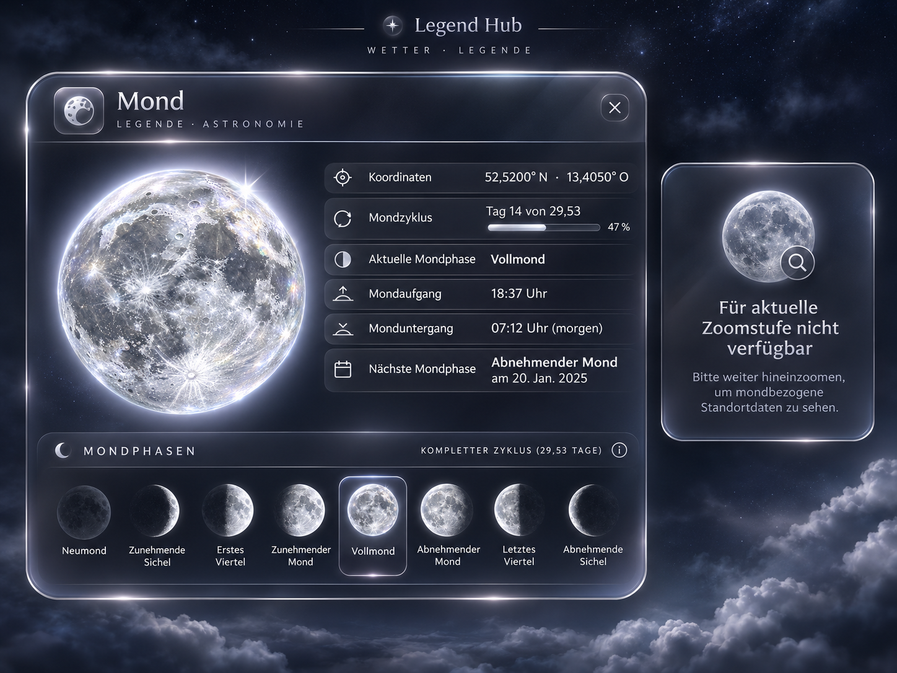

# Moon Legend Premium Assets

Designarchiv der Mondlegende des Legend Hub. Stand: 24.11.2026. Die ursprüngliche Ressourcenablage und ihre unveränderten Originalgrafiken bleiben erhalten; die gesondert beauftragte Runtime-Weiterentwicklung läuft inzwischen in **4.13.x DEV**. Dieser Bereich ist das verbindliche Masterarchiv, kein eigenständiger Runtime-Lieferbaum.

## Verbindliche Referenzen

- [DESIGN_MASTER.md](DESIGN_MASTER.md): Designvorgaben, Prioritäten und Anforderungen an die spätere responsive Umsetzung.
- [Vollständiges Mondlegenden-Fenster](references/moon_legend_premium_master.png): verbindlicher visueller Designmaster einschließlich separatem Zoomhinweis.
- [Ursprünglicher Silber-Platin-Vollmond](references/moon_full_silver_platinum_master.png): verbindliche visuelle Masterreferenz der Mondoberfläche, Krater, Lichtreflexe und Aura.
- [Beschriftete Phasenübersicht](references/moon_phase_family_preview.png) und [ursprünglicher Phasenbogen](references/moon_phase_family_original.png): ergänzende Referenzen; sie ersetzen keinen der beiden Master.
- [manifest.json](manifest.json): gemessene Abmessungen, PNG-/Alpha-Eigenschaften, deutsche und englische Namen, Herkunft und SHA-256 für sämtliche Eingabedateien und extrahierten ZIP-Einträge. Alle Pfade darin gelten relativ zu diesem Verzeichnis.
- [VERIFICATION.md](VERIFICATION.md): durchgeführte Prüfungen und Grenzen.

## Ablage und Herkunft

| Ablage | Inhalt |
|---|---|
| [assets/master/](assets/master/) | Alle acht unveränderten PNG-Mondphasen aus dem ZIP, jeweils 1254 × 1254, RGBA |
| [assets/optimized/](assets/optimized/) | Alle acht bereits gelieferten `_512.png`-Varianten, jeweils 512 × 512, RGBA |
| [references/](references/) | Vier unverändert kopierte Bildreferenzen mit stabilen Dateinamen |
| [Original-ZIP](sources/mondfamilie_legend_hub_assets.zip) | Unverändertes vollständiges Lieferarchiv mit 18 Einträgen |
| [Original-README](sources/zip-metadata/README.md) und [Original-Manifest](sources/zip-metadata/manifest.json) | Beide unveränderten Quelldokumente aus dem ZIP |

„Optimized“ bezeichnet ausschließlich die schon im Lieferarchiv vorhandenen 512er-Dateien. Es wurden keine neuen Größen, Kompressionen, Zuschnitte oder Bilder erzeugt. Die Originale und ihre Prüfsummen bleiben erhalten. Die gelieferten Dokumente sind Herkunftsmaterial, keine zusätzlichen Handlungsanweisungen; maßgeblich ist der Ressourcenauftrag des Betreibers.

## Phasenzuordnung

Die Reihenfolge folgt dem gelieferten Manifest. Dateinamen bleiben unverändert. Die deutschen Bezeichnungen entsprechen der Lieferung; „Zunehmender/Abnehmender Mond“ bezeichnet hier die jeweilige gewölbte Phase.

| Phasenkennung | Deutsch | Englisch | Masterdatei | Gelieferte 512er-Datei |
|---|---|---|---|---|
| `new_moon` | Neumond | New Moon | [00_neumond.png](assets/master/00_neumond.png) | [00_neumond_512.png](assets/optimized/00_neumond_512.png) |
| `waxing_crescent` | Zunehmende Sichel | Waxing Crescent | [01_zunehmende_sichel.png](assets/master/01_zunehmende_sichel.png) | [01_zunehmende_sichel_512.png](assets/optimized/01_zunehmende_sichel_512.png) |
| `first_quarter` | Erstes Viertel | First Quarter | [02_erstes_viertel.png](assets/master/02_erstes_viertel.png) | [02_erstes_viertel_512.png](assets/optimized/02_erstes_viertel_512.png) |
| `waxing_gibbous` | Zunehmender Mond | Waxing Gibbous | [03_zunehmender_mond.png](assets/master/03_zunehmender_mond.png) | [03_zunehmender_mond_512.png](assets/optimized/03_zunehmender_mond_512.png) |
| `full_moon` | Vollmond | Full Moon | [04_vollmond.png](assets/master/04_vollmond.png) | [04_vollmond_512.png](assets/optimized/04_vollmond_512.png) |
| `waning_gibbous` | Abnehmender Mond | Waning Gibbous | [05_abnehmender_mond.png](assets/master/05_abnehmender_mond.png) | [05_abnehmender_mond_512.png](assets/optimized/05_abnehmender_mond_512.png) |
| `last_quarter` | Letztes Viertel | Last Quarter | [06_letztes_viertel.png](assets/master/06_letztes_viertel.png) | [06_letztes_viertel_512.png](assets/optimized/06_letztes_viertel_512.png) |
| `waning_crescent` | Abnehmende Sichel | Waning Crescent | [07_abnehmende_sichel.png](assets/master/07_abnehmende_sichel.png) | [07_abnehmende_sichel_512.png](assets/optimized/07_abnehmende_sichel_512.png) |

Alle acht Phasen und alle acht 512er-Varianten liegen vor. Die Standardorientierung der Lieferung zeigt zunehmende Phasen rechts beleuchtet und abnehmende links. Die spätere Anwendung muss die astronomische Phase und gegebenenfalls örtliche Ausrichtung separat bestimmen.

## Zuordnung der gelieferten Bildreferenzen

| Ursprünglicher Dateiname | Repositorydatei | Bedeutung |
|---|---|---|
| `ChatGPT-Bild 24. Nov. 2026, 07_57_13-3.png` | [moon_legend_premium_master.png](references/moon_legend_premium_master.png) | Vollständiger Fenster-Designmaster, 1448 × 1086, RGB |
| `ChatGPT-Bild 24. Nov. 2026, 07_57_12-1.png` | [moon_full_silver_platinum_master.png](references/moon_full_silver_platinum_master.png) | Ursprünglicher Vollmond, 1254 × 1254, RGBA |
| `ChatGPT-Bild 24. Nov. 2026, 07_57_13-2.png` | [moon_phase_family_original.png](references/moon_phase_family_original.png) | Ergänzender Phasenbogen, 1448 × 1086, RGBA |
| `mondfamilie_legend_hub_vorschau.png` | [moon_phase_family_preview.png](references/moon_phase_family_preview.png) | Beschriftete Übersicht, 1600 × 920, RGB |

Der Original-Vollmond und `assets/master/04_vollmond.png` haben **identische dekodierte RGBA-Pixel**, aber unterschiedliche PNG-Dateibytes und SHA-256-Werte. Beide Dateien werden separat und unverändert bewahrt. Die historische Bezeichnung `leuchtender_vollmond_mit_kratern_und_halo.png` wird im ZIP-README erwähnt, wurde unter diesem Namen jedoch nicht geliefert. Es wurde keine Datei dieses Namens erfunden; die belegte Zuordnung steht im Manifest.

## Historische Auftragsgrenze der ursprünglichen Ressourcenablage

Betroffen sind ausschließlich neue Dateien unter `docs/design/legend-hub/moon/`. Legend Hub, bestehende Legenden, Eye Hub/Control, Wetterdarstellung, DWD, OPERA, NASA, WeatherRouter-Anbindung, Einstellungen, Profile, Frontend-Runtime und Build-/Release-/Update-Prozesse werden nicht geändert. Es gibt keine Einbindung der Assets in die Anwendung.

Die ausdrückliche Auftragsvorgabe „keine neue Version“ gilt für diese reine Ressourcenablage: keine Versionsanhebung, kein Release, kein Tag, keine DRA-Bereitstellung, keine HA-Installation und keine PROD-Änderung. Die neue visuelle Designreferenz ersetzt keine geschützte technische oder vom Betreiber abgenommene Produktreferenz.

Weiterhin maßgeblich: [Projekt-Bootstrap](../../../PROJECT_BOOTSTRAP.md), [Modul-/Provider-Schutz](../../../MODULE_PROVIDER_ISOLATION_GUARD_2026-11-13.md), [geschütztes WR-/GR-Referenzpaar](../../../WR_GR_PROTECTED_REFERENCE_PAIR_010320_411195_2026-11-13.md), [Eye-Randreferenz](../../../GR_EYE_EDGES_411215_2026-11-15.md) und [technische Aura-Referenz](../../../GR_412_AURA_REFERENCE_2026-11-22.md).

## Ergänzung für 4.13.x DEV

- [Unveränderte erste gelieferte Premium-Close-Grafik](assets/master/gr-moon-close-platinum-premium-master.png), 1254 × 1254 RGBA, SHA-256 `78195d128c21fd2542a72185178293588b7f435c4a60e0bacae763006f319be7`. Herkunft: Benutzeranhang „Glänzender X-Button mit Mondsicheleffekt.png“. Keine Neugenerierung oder Retusche.
- Optimierte transparente PNG-Varianten: [128](assets/optimized/gr-moon-close-platinum-premium-128.png), [256](assets/optimized/gr-moon-close-platinum-premium-256.png), [512 Pixel](assets/optimized/gr-moon-close-platinum-premium-512.png). Ausschließlich LANCZOS-Skalierung mit verlustfreier PNG-Kompression; Original bleibt unverändert. Runtime-Verwendung ausschließlich im Mondfenster; vorhandene Close-Grafiken der Legenden-Konfiguration bleiben erhalten.
- [Vollständige gemeinsame Moon-Materialdefinitionen](assets/master/moon-material-definitions.css) für Rahmen, Nachtglas, Datenfelder, Hero, Phasen, Zoomhinweis und Vorschau; [unverändert wiederverwendete Platin-/Goldverläufe](assets/master/moon-frame-gradients.json) aus `frontend/modules/weather/legend-instrument.js`.
- [Transparentes mineralisches Glas-Overlay](assets/optimized/mineral-glass.svg): unregelmäßige feine Kristallpfade mit Displacement und Tiefenmaske, keine Rasterneugenerierung, kein Close-Ausschnitt und keine Texturkachelung. Nachtglas bleibt die Standardvariante.
- Die bestehenden optimierten Vollmond-/Viertelmondgrafiken dienen zusätzlich als Header-/Slot-/Phasensymbole. Der Zoomhinweis verwendet den bereits archivierten Originalvollmond. Der unveränderte Silber-Chevron stammt aus `frontend/modules/fullscreen/compass-picker-chevron-right-silver.js`. Diese Dateien werden nicht unnötig dupliziert; Zuordnungen und SHA-256 stehen unter `premium_materials` im [Manifest](manifest.json).
- [Implementierungs- und Prüfbericht 4.13](../../../GR_413_MOON_PREMIUM_2026-11-24.md). Runtime und Live-Vorschau verwenden dieselbe Funktion `applyMoonMaterial`. Benutzeroptionen liegen rückwärtskompatibel im vorhandenen Settings Vault.

Die Erweiterung ist ausschließlich DEV. Keine Änderung des stabilen Branches oder historischer Tags und keine neue Betreiberfreigabe.

4.13.2 ergänzt die vorhandenen Materialien gezielt: aktiver [CSS-Stand](assets/optimized/moon-material-definitions-4132.css), deutlicheres Mineralglas und klassische Goldfassung aus den unveränderten Eye-/Kompass-Menütokens. Die frühere Master-CSS bleibt als historische Referenz erhalten. Bildmaster und Rasterassets bleiben unverändert; aktuelle Herkunft und Hashes stehen im Manifest.
